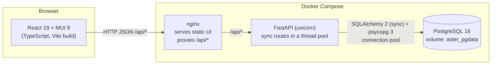
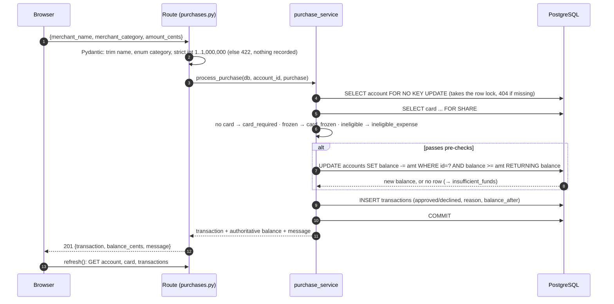
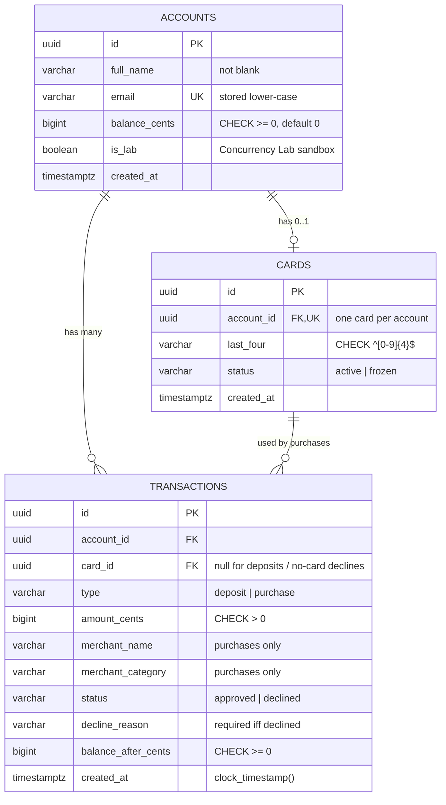

# Aster HSA — Architecture

This document describes the system as it is implemented in this repository. File references point at the code that implements each idea.

## 1. System architecture



**Frontend** (`frontend/src`). A single-page React app with five screens: Overview, Activity, Card & purchases, Account, and Concurrency Lab. It also has dialogs for opening an account and adding funds, and a "Get started" checklist on the Overview that guides a new account through its first deposit, card and purchase (it is derived from the account's real history and disappears once all three are done).

- `api/` has one small typed function per endpoint, and a single base URL, `/api`.
- `state/AccountContext.tsx` holds the selected account and the server data shown for it.
- After every mutation the UI calls `refresh()`, which **re-reads** the balance, card and history from the API. The browser never computes a balance it then trusts.

**Proxy.** In Docker, nginx serves the built assets and forwards `/api/*` to the backend. In development, the Vite dev server does the same. The browser only talks to one origin, so there is no CORS configuration.

**Backend** (`backend/app`). FastAPI with **synchronous** route functions, which FastAPI runs in a worker thread pool, so requests really do run concurrently.

- Routes (`routes/`) are thin. They validate input with Pydantic, call a service, and shape the response.
- Business rules live in `services/`.
- Each request gets its own SQLAlchemy `Session`, and therefore its own pooled database connection, via the `get_db` dependency.
- Services raise domain errors (`NotFoundError` → 404, `ConflictError` → 409), which `main.py` maps to HTTP responses.

**Database.** PostgreSQL 16 is the single source of truth for balances. The schema is created by one Alembic migration (`alembic/versions/0001_initial_schema.py`), applied automatically when the backend container starts.

### Why these choices

| Choice | Reason |
|---|---|
| PostgreSQL rather than SQLite | Real row-level locking and `CHECK`/`UNIQUE` constraints are what make concurrency safe. Tests must exercise the real engine. |
| Sync SQLAlchemy + sync routes | Simple, explicit transaction boundaries, and no mixing of `async` routes with blocking database calls. The thread pool gives concurrency. |
| Thin routes, small services | Each money rule can be read in one file (`services/purchase_service.py`). |
| `fetch` + React context, no extra state libraries | The data needs are small. One context with an explicit `refresh()` is easy to follow. |
| Integer cents | Exact arithmetic. No floating-point rounding errors anywhere. |

## 2. Request flow

### Simulated purchase (`POST /api/accounts/{id}/purchases`)



**Commit boundary.** Everything between the first `SELECT` and `COMMIT` is **one database transaction**, and the account row lock is held for all of it. That includes the balance change and the history insert. The response is built only after the commit succeeds. If anything raises before the commit (for example, the history `INSERT` violates a constraint), the session is closed without committing, PostgreSQL rolls back, and no debit survives. `tests/test_integrity.py::test_failed_history_insert_rolls_back_the_debit` proves this by forcing the insert to fail *after* the debit has run.

**Check order.** The checks run in a fixed order: card exists → card active → category eligible → funds. Eligibility is checked before funds, so an ineligible purchase is reported as `ineligible_expense` even if the balance is also too low. That is the more useful explanation. A declined purchase returns **201** (a record was created) with `status: "declined"`. Only malformed requests are HTTP errors.

### Deposit (`POST /api/accounts/{id}/deposits`)

A deposit runs `UPDATE accounts SET balance_cents = balance_cents + :amount WHERE id = :id RETURNING balance_cents`. If no row comes back, the account doesn't exist (404). Then it inserts the deposit row and commits, all in one transaction (`services/account_service.py::deposit`).

### Card issuance (`POST /api/accounts/{id}/cards`)

Card issuance runs `INSERT … ON CONFLICT (account_id) DO NOTHING RETURNING id`, then reads the card back. The `UNIQUE(account_id)` constraint decides the winner if two requests race. The loser simply gets the existing card (200 instead of 201), so there is never a duplicate and never a 500 (`services/card_service.py`).

### Transaction history (`GET /api/accounts/{id}/transactions`)

History is read newest-first, one page at a time, with **keyset (cursor) pagination**:

- The response is `{items, next_cursor, total_count}`. `next_cursor` is an opaque string that identifies the last row of the page by its `(created_at, id)`; `null` means there is nothing older. `total_count` is the number of rows matching the filters across all pages, so the UI can say "Showing 25 of 143".
- The next page is "rows strictly older than the cursor row": `WHERE (created_at, id) < (:cursor_created_at, :cursor_id) ORDER BY created_at DESC, id DESC LIMIT :n + 1`. Asking for one extra row is how the server knows whether another page exists.
- Why a cursor instead of page numbers: history is append-only and new rows arrive at the top. With `OFFSET`, a deposit made while someone is on page 1 would push an old row onto page 2 and show it twice. With a cursor, every page is defined relative to a fixed row, so rows inserted mid-walk never cause duplicates or gaps. `created_at` can tie (rows committed in the same microsecond), which is why `id` is part of the key.
- Filters (`type`, `status`) and search (`q`) are applied by the database and must be repeated on every page request, so paging and filtering always agree. Search is a case-insensitive "contains" match on merchant name, category, decline reason (with `_` shown as a space, so "insufficient funds" matches) and type; `%`, `_` and `\` in the query are escaped and matched literally.
- The count and the page are read in one `REPEATABLE READ` snapshot, so they can't disagree while other requests commit.
- A cursor that doesn't decode returns 422 with a message telling the client to restart from the first page. A blank `?cursor=` or `?q=` means "first page" / "no search".

The Activity page requests 25 rows at a time, appends older pages with a **Load more** button, and sends the search to the server after a short pause in typing. Tests in `tests/test_history_pagination.py` walk every page and check that rows inserted mid-walk, identical timestamps, filters and search all behave.

### How the UI stays correct

After a mutation succeeds, the UI awaits `refresh()`. It then renders the **server's** balance, card and history. The purchase receipt shows `balance_cents` from the response, not a value computed in the browser.

The context tags loaded data with the account ID it belongs to. A slow response for a previously selected account is therefore never shown for the current one (`state/AccountContext.tsx`).

## 3. Data model



### What an account needs, and what it deliberately doesn't

The assignment asks each candidate to "define the account information your system needs". The rule I used: store only what a simulated flow actually reads, and derive everything else from history.

| Field | Why it exists | How it is validated |
|---|---|---|
| `id` (UUID) | A stable identifier for URLs and foreign keys that doesn't reveal how many accounts exist, unlike a sequential number. | Generated by the database. |
| `full_name` | Shown as the cardholder name on the virtual card, in the account switcher and on the overview. | Trimmed, inner whitespace collapsed, 1–120 characters, no control characters (API). `CHECK (length(trim(full_name)) > 0)` (database). |
| `email` | The account's unique identity, and the natural duplicate check. A real provider would also use it for statements and verification. | Trimmed, lower-cased, basic `name@domain.tld` check (API). `UNIQUE` plus `CHECK (email = lower(email))` (database), so two sign-ups with the same email in different cases can't both succeed, even when they race. A duplicate returns 409 with a message the form shows inline. |
| `balance_cents` | The available funds the conditional `UPDATE` races on. | Starts at 0. Integer only. `CHECK (balance_cents >= 0)`. Changed only by atomic SQL in the deposit and purchase services, never set directly from a request (unknown request fields are rejected). |
| `created_at` | "Opened" date on the overview. | Set by the database. |
| `is_lab` | Marks Concurrency Lab sandboxes so they stay out of the account switcher. | Internal flag; not settable through the API. |

**Derived, not stored:** total deposited, total spent, approved/declined counts and spending by category are computed from the transaction history on request. Storing them would create a second copy of the truth that could drift from the balance.

**Deliberately excluded.** A real HSA custodian must collect more, and each item below is left out on purpose:

| Not collected | Why a real provider needs it | Why this simulation doesn't |
|---|---|---|
| SSN / tax ID, date of birth, address | Identity verification (KYC) and IRS reporting (Forms 5498-SA and 1099-SA). | No real tax reporting happens. Holding this data in a demo is pure risk with no benefit. |
| Proof of high-deductible health plan enrolment and coverage type (self-only / family) | HSA eligibility and the annual contribution limit depend on it. | Eligibility isn't simulated and deposits have a flat $10,000 cap. Coverage type would be the first field to add if contribution limits were implemented (see §7). |
| Bank account and routing numbers | Real deposits move money over ACH. | Deposits are simulated: no money moves, so there is nothing to connect. |
| Card number (PAN), CVV, expiry | A real card network needs them. | The card stores four random display digits only, which keeps all payment-card data (and PCI scope) out of the project. |
| Password or login | Multi-user access control. | A local, single-user demo. Any visitor can act on any account, and the README says so. |
| Phone, employer, beneficiaries | Contact, payroll contributions, inheritance rules. | No flow uses them. |

The validation rules are in `backend/app/schemas/account.py` and `backend/app/models/account.py`; the sign-up race test is `tests/test_concurrency.py::test_concurrent_duplicate_signups_create_one_account`.

### Why this shape

- **`accounts.balance_cents`** stores the current available balance. It is the value the conditional `UPDATE` races on, which is exactly what makes the concurrency guarantee simple and provable. The alternative is computing the balance as `SUM(transactions)` on every purchase. That would need a lock on the account (or serializable isolation) anyway, and it becomes slower as history grows.
- **`transactions` is an append-only history.** Every deposit and every well-formed purchase attempt is recorded, including declines and their reason, so the activity view can explain exactly what happened. `balance_after_cents` records the balance right after the row was processed. For a decline, this is the unchanged balance at decision time. Because the row is written in the same database transaction as the balance change, the invariant *balance = approved deposits − approved purchases* always holds. The tests assert it after every concurrency scenario.
- **`cards`** is deliberately minimal and cosmetic. It stores four random display digits, never a card number (PAN), CVV or expiry. `UNIQUE(account_id)` enforces "each account may have a virtual card" at the database level.
- **UUID primary keys** avoid exposing sequential counts in URLs.
- **`VARCHAR` + `CHECK` rather than PostgreSQL `ENUM` types.** These are easier to migrate later. The allowed values come from the Python enums in `app/enums.py`, so the API and the database agree. `merchant_category` is validated by the API enum but has no database `CHECK`, so adding a category only needs a code change. This is a deliberate tradeoff.
- **Database-level integrity, not just application checks:**
  - balance and `balance_after` are ≥ 0
  - amounts are > 0
  - a declined row must have a reason, and an approved row must not
  - deposits can't carry a card or merchant
  - purchases must name a merchant and category
  - email must be lower-case and unique

  `tests/test_integrity.py` writes invalid rows directly with SQL and confirms PostgreSQL rejects them.
- **Index** `(account_id, created_at)` serves the newest-first history query and the cursor condition that pages through it.
- **`created_at` on transactions uses `clock_timestamp()`** (the insert moment) instead of `now()` (transaction start). For a purchase that waited on a row lock, `now()` would be earlier than the moment it was actually decided. `clock_timestamp()` makes history order match commit order.

## 4. Concurrency handling

### The problem

A naive implementation reads the balance, checks it in Python, and writes `balance - amount`. That is a classic lost-update race. Two requests both read $100, both pass the check, and both write. The $80 request writes $20, the $50 request writes $50, and **both purchases are approved** even though only $100 existed. This can't be fixed with a Python lock either, because several worker threads, processes or servers may serve requests.

### The mechanism

The database is the arbiter, through two cooperating pieces in `services/purchase_service.py`.

**1. The atomic, conditional debit.** The money moves in a single statement:

```sql
UPDATE accounts
   SET balance_cents = balance_cents - :amount
 WHERE id = :account_id AND balance_cents >= :amount
RETURNING balance_cents;
```

The check and the subtraction happen in one step inside PostgreSQL, against the latest committed balance, so no other request can change the balance between "is there enough?" and "take it". If no row comes back, the funds were insufficient and nothing changed. On its own, this statement already makes overspending impossible: concurrent `UPDATE`s on one row queue on its lock and re-check the `WHERE` clause against the new value.

**2. An account row lock taken first.** Each purchase starts with `SELECT balance_cents FROM accounts WHERE id = :id FOR NO KEY UPDATE`. That is the same lock an `UPDATE` takes, acquired at the start and held until `COMMIT`. Deposits take it too, through their own `UPDATE`. So every operation on one account takes turns, including purchases that end up *declined*. As a result, the balance recorded on a declined row is exact, and the history always reads as a clean chain where each row's `balance_after` equals the previous row's plus or minus its amount. Different accounts never block each other.

Why the lock is needed in addition to the debit: without it, an ineligible purchase that never runs the `UPDATE` would read the balance while another request was mid-flight, and record a stale value. This was found in review and reproduced with a deposit racing a decline, which then showed "Insufficient funds" next to a balance that would have covered it. It is now covered by tests (see below).

Under PostgreSQL's default `READ COMMITTED` isolation, the race between $80 and $50 on a $100 balance plays out like this:

| Time | Request A ($80) | Request B ($50) |
|---|---|---|
| t1 | Locks the account row (`FOR NO KEY UPDATE`), reads $100 | |
| t2 | | Tries to lock the same row and **waits** |
| t3 | Card active, pharmacy eligible → conditional `UPDATE` matches, balance → $20 | (still waiting) |
| t4 | `INSERT` approved row (balance_after $20); `COMMIT` → lock released | |
| t5 | | Gets the lock and reads the committed **$20** |
| t6 | | Conditional `UPDATE … WHERE balance >= 5000` matches 0 rows → `insufficient_funds` |
| t7 | | `INSERT` declined row (balance_after $20); `COMMIT` |

Exactly one request wins. Which one depends on arrival order: the final balance is $20 (if $80 won) or $50 (if $50 won). A negative balance is impossible, and ineligible purchases never reach the `UPDATE`, so only valid transactions can debit. Lock order is always account → card, and the only other card writer (freeze) touches just the card, so there is no deadlock cycle.

**Defence in depth:**

- **`CHECK (balance_cents >= 0)`** on `accounts`. Even a future bug that issued an unconditional `UPDATE` would fail with an integrity error instead of storing a negative balance.
- **`SELECT … FOR SHARE` on the card row** during a purchase. A concurrent "freeze card" (which needs a row lock to update the card) waits for in-flight purchases to commit, so it can't slip in between the status check and the debit.
- **Unique constraints** settle the other races: the email `UNIQUE` handles duplicate sign-ups (the loser gets a 409), and `cards.account_id` `UNIQUE` handles duplicate card issuance.
- **Deposits** use the same atomic pattern (`balance_cents + :amount`), so concurrent deposits are never lost.

### How it is verified

All concurrency tests run against **real PostgreSQL** in a dedicated `aster_test` database (`backend/tests/test_concurrency.py`). Each simulated request runs in its own thread with its **own session and connection**. A `threading.Barrier` releases them at the same instant. After every scenario, `assert_balance_matches_history` checks that the stored balance equals the history total **and** that the history is an exact `balance_after` chain.

| Test | Result asserted |
|---|---|
| $80 + $50 on $100, ×15 rounds | exactly 1 approved, 1 `insufficient_funds`; final balance $20 or $50 |
| 20 × $10 on $100 | exactly 10 approved, final balance $0 |
| 5 pharmacy + 10 restaurant/electronics × $30 on $100 | 3 approved (all pharmacy), 10 `ineligible_expense`, balance $10 |
| 20 concurrent $5 deposits | balance $100 (no lost updates) |
| 10 deposits racing 10 purchases | balance equals approved deposits − approved purchases |
| 8 deposits + 8 eligible + 8 ineligible + 4 unaffordable purchases | 8 `ineligible_expense`, the 4 large ones `insufficient_funds`, exact history chain |
| Deterministic interleaving | A debits without committing; B is observed (via `pg_stat_activity`) **waiting on the row lock**; after A commits, B declines and records $20 |
| HTTP race through a live uvicorn server | 1 approved, 1 declined per round; balance $20 or $50 |
| 10 concurrent card issues / 8 duplicate sign-ups | exactly one card / one account |

**Do the tests actually detect races?** During development, the conditional `UPDATE` was temporarily replaced with a naive read-check-write. **19 of the 23 concurrency tests that existed at the time failed**, and 20 of 23 failed when a 50 ms delay widened the race window. The only ones that still passed don't involve a purchase debit. They passed again once the real implementation was restored. Separately, removing the up-front account lock made the history-chain tests fail in 5 of 5 runs. 
The **Concurrency Lab** page (`frontend/src/pages/LabPage.tsx`) does the same thing interactively. It creates an isolated sandbox account (`is_lab = true`, hidden from the account list) with $100 and a card. It then fires the purchases from the browser at the same time through the normal purchase endpoint. Finally, it shows each real response, the final balance read back from the database, and the order the server committed them. Nothing in it is hard-coded. Browsers limit parallel connections per site (around 6), so a 20-request burst arrives in a few waves. The automated tests are the precise proof.

## 5. Validation and rejection rules

| Input | Rule | Result |
|---|---|---|
| `amount_cents` | strict JSON integer, 1 to 1,000,000 ($10,000). `50.5`, `5000.0`, `"5000"`, `true`, 0 and negatives are rejected | 422, nothing recorded |
| `merchant_category` | one of the nine enum values (lower-case) | 422 otherwise |
| `merchant_name` | trimmed, 1–80 characters | 422 otherwise |
| `full_name` / `email` | trimmed (inner whitespace collapsed) / lower-cased, basic format check | 422, or 409 for a duplicate email |
| Unknown account | | 404 |
| Valid purchase, no card / frozen / ineligible / short of funds | | 201, declined with a reason, no debit |

On the frontend, `lib/money.ts::parseDollarsToCents` converts what the user typed (`"12.34"`, `"$1,200"`, `".50"`) to integer cents by splitting the string. It does not multiply a float. It also rejects three decimal places, exponent notation, negatives and amounts over the limit. These rules are covered by 35 Vitest cases (`lib/money.test.ts`). The backend validates again regardless.

## 6. Design tradeoffs

- **Stored balance vs. derived ledger.** A stored balance with an atomic conditional `UPDATE` is simple and fast, and it makes the race easy to reason about. A double-entry ledger (with holds, settlement and reversals) is what production money systems use. It would be the next step, but it is heavier than this assignment needs.
- **Declines are 201, not 4xx.** A decline is a legitimate, recorded outcome that the UI explains, which is different from a malformed request.
- **Recording declines** costs a row per attempt, but it gives a full audit trail. It also lets the demo show that nothing was deducted.
- **Merchant category as the eligibility proxy.** This is required by the assignment's examples. It is easy to read and test, but it is not how real HSA eligibility works. Real eligibility is item-level (IIAS / IRS Publication 502).
- **`READ COMMITTED` + conditional `UPDATE`** instead of `SERIALIZABLE` isolation. It needs no retry loop and it is the standard pattern for single-row balance changes. `SERIALIZABLE` would also be correct, but it would require retrying serialization failures.
- **No idempotency keys.** A client that retries a timed-out purchase could double-charge. This is the most important production gap, and it is listed below rather than half-built.
- **The `is_lab` column** exists only to keep Concurrency Lab sandboxes out of the account switcher. The alternative was letting demo runs clutter real data.
- **Cursor pagination over offset pagination.** Cursors can't jump to "page 7", but history is browsed newest-first and never needs random access. In exchange, pages stay exact while new rows arrive, and the query uses the `(account_id, created_at)` index instead of scanning and discarding `OFFSET` rows.
- **The balance summary is computed on read** with aggregate SQL, inside one `REPEATABLE READ` snapshot so the balance and totals always agree. That is fine at demo scale. At larger scale it would be cached or maintained incrementally.
- **Serializing per account.** Each purchase holds its account's row lock for the length of one short transaction. This caps throughput *per account* (not across accounts), which is the right trade for a balance that must be exact. A sustained stream of overlapping purchases could also make a "freeze card" request wait, because it needs the card row that purchases hold in shared mode.
- **Lab sandboxes** are created with three short commits (account, deposit, card) and are never deleted. A failure partway would leave a hidden, partly set-up sandbox, which is harmless because it is excluded from the account list.
- **No authentication.** Any visitor can act on any account. That is acceptable for a local single-user demo, and it is stated plainly.

## 7. What I would improve with more time

1. **Idempotency keys** on deposits and purchases. A unique `(account_id, idempotency_key)` would make retries return the original result.
2. **Authentication and authorization.** Users should only see their own accounts.
3. **A double-entry ledger** with authorization holds and settlement, instead of an immediate debit.
4. **Real eligibility rules.** Item-level data (IIAS), and possibly substantiation and receipts.
5. **IRS annual contribution limits**, plus per-account contribution tracking.
6. **Richer history tools** on top of the cursor API: date-range filters and CSV export.
7. **Observability.** Structured logs, request IDs and metrics on declines and lock waits.
8. **More frontend tests.** Component tests and a committed Playwright E2E suite. The E2E walkthrough was run during development but isn't part of the repository.
